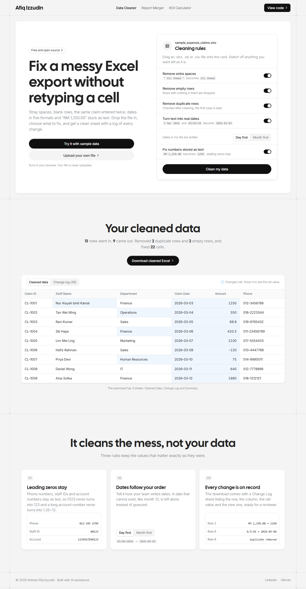

# Excel Data Cleaner

Clean a messy Excel export in one click, with every change logged.

**[Open the live tool](https://afiqizzudinnn.github.io/excel-data-cleaner/)** · [See it with sample data](https://afiqizzudinnn.github.io/excel-data-cleaner/?demo)

## The problem

Exports from HR, finance and sales systems are rarely clean. Before anyone can build a report, someone has to:

- remove stray spaces that break lookups and filters
- delete blank rows
- hunt down duplicate rows
- retype dates that arrive in five different formats
- turn "RM 1,250.00" back into a number so it can be added up

It is slow, boring and easy to get wrong, and nobody keeps a record of what was changed.

## What it does

| Fix | Before | After |
|---|---|---|
| Extra spaces | `"  Ali   Ahmad "` | `Ali Ahmad` |
| Empty rows | blank rows in the middle of the data | removed |
| Duplicate rows | the same claim entered twice | first copy kept |
| Mixed dates | `03/03/2026`, `3 Mar 2026`, `11 Mac 2026` | real Excel dates shown as `2026-03-03` |
| Numbers stored as text | `"RM 1,250.00"`, `"(120.00)"` | `1250`, `-120` |

Every change goes into a **Change Log** sheet (Excel row, column, before, after), so a reviewer or auditor can check the work.

## Safe by design

- **Your file never leaves your computer.** Everything runs inside the browser. Nothing is uploaded.
- **Phone, IC and account numbers stay as text**, so leading zeros and long digits are not lost.
- **Dates follow the order you choose**: day first (Malaysia, UK) or month first (US).
- **Nothing is hidden.** Changed cells are highlighted, and you can switch off any fix you do not want.

## Business impact (estimate)

If one analyst cleans one export a day and the tool saves 20 minutes each time, that is about **88 hours a year** (20 min × 22 days × 12 months). Try your own numbers in the [Automation ROI Calculator](https://afiqizzudinnn.github.io/automation-roi-calculator/).

## How to use

1. Open the [live tool](https://afiqizzudinnn.github.io/excel-data-cleaner/).
2. Drop in an `.xlsx`, `.xls` or `.csv` file, or click **Try it with sample data**.
3. Switch off anything you do not want fixed, then click **Clean my data**.
4. Check the highlighted cells and the change log, then click **Download cleaned Excel**.

The download has 3 sheets: Cleaned Data, Change Log and Summary.

## How it is built

- One `index.html` file. No server, no database, no install.
- [SheetJS](https://sheetjs.com/) reads and writes Excel files in the browser.
- Plain JavaScript applies the cleaning rules in a fixed order: spaces, then dates, then numbers, then empty rows and duplicates.

To run it on your own computer, download `index.html` and open it in Chrome or Edge. It needs internet once to load SheetJS.

## About

Built by **Ahmad Afiq Izzudin**, Business Process & Automation Analyst. I designed the process and the cleaning rules, and used AI assistance to write the code faster.

[LinkedIn](https://www.linkedin.com/in/afiq-izzudin-27aaa936b) · Part of my Office Toolkit, together with the [Excel Report Merger](https://github.com/Afiqizzudinnn/excel-report-merger) and the [Automation ROI Calculator](https://github.com/Afiqizzudinnn/automation-roi-calculator).

All sample data is made up. Licensed under MIT.
